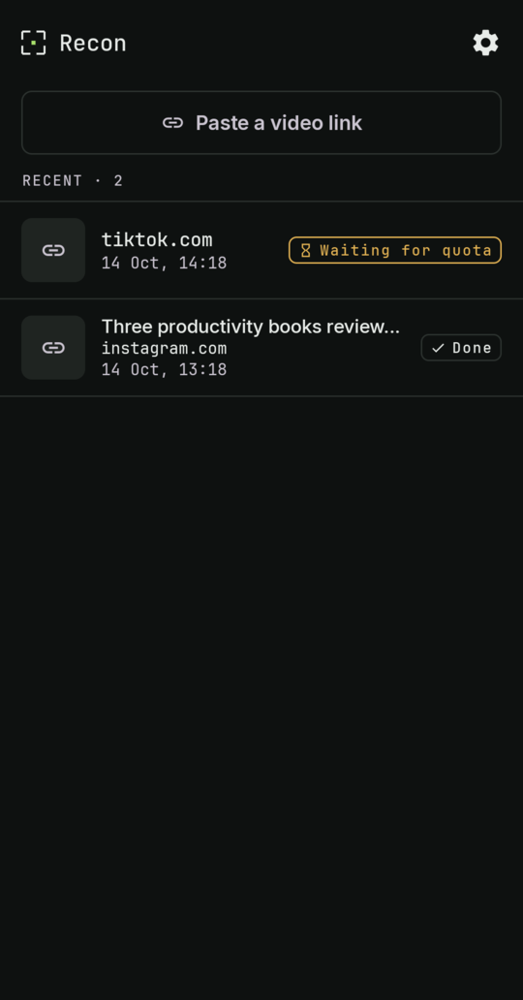
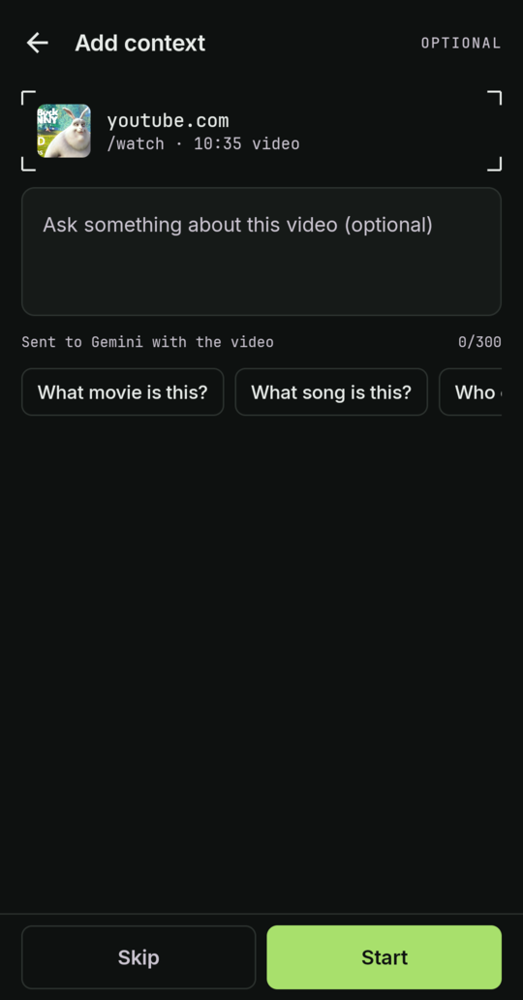
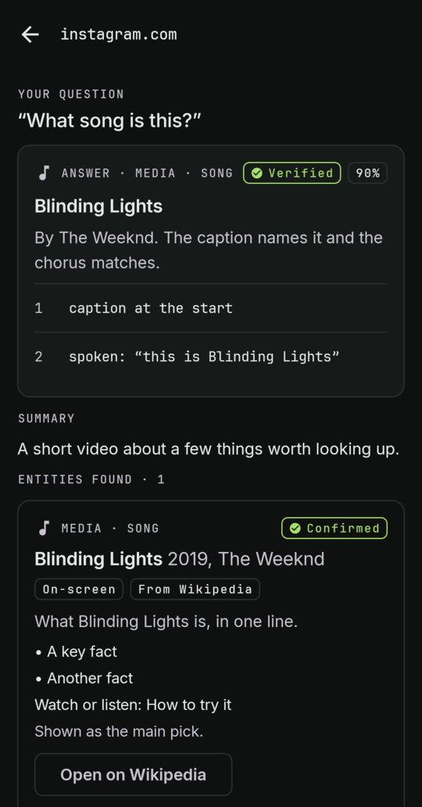
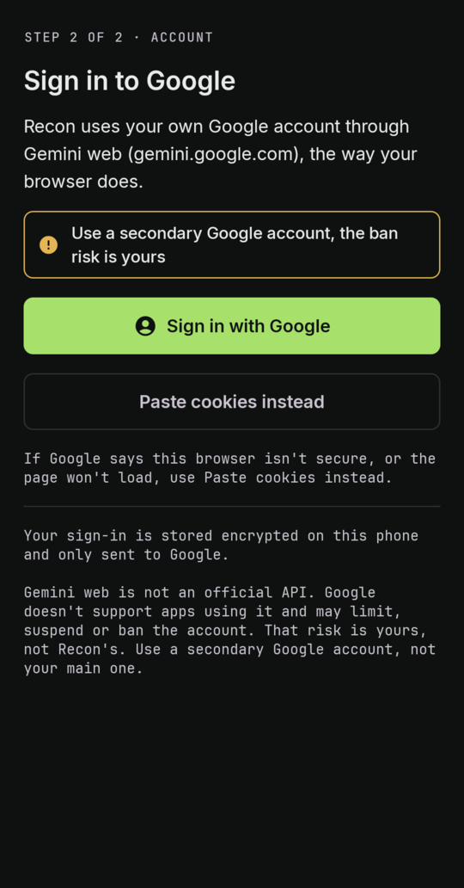
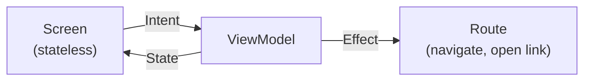

<div align="center">


# Recon

**Share a short video from any app. Find out what's in it.**

Recon tells you what a video is about, then looks up the specific things it mentions:<br>
apps, books, places, repos, products, with sources where it can.

[](https://github.com/w0lzard/Recon/releases/latest)


[**Download**](https://github.com/w0lzard/Recon/releases/latest) · [Install](#install) · [Verify](#verify-the-download) · [Privacy](#privacy) · [Architecture](#architecture) · [Build](#building)

<br>

&nbsp;
&nbsp;
&nbsp;


</div>

<br>

## What it does

| | |
|---|---|
| **Share** | Send a video link, or the video itself, to Recon from Instagram, TikTok, X, YouTube or any app with a share sheet. |
| **Watch** | Gemini watches it with your own Google account: frames and audio, in temporary chats. |
| **Look up** | Each thing it names is checked against GitHub and Wikipedia, so you get a real link, not just a guess. |
| **Show its working** | Each result says how it was found (spoken, on screen, or a guess) and how well it matched, with its sources. |

See [`docs/plan.md`](docs/plan.md) for the full plan.

## Saving videos

Recon can save a high-quality copy of an analysed video for personal use. On any result with a web link, tap **Save video** to choose from three presets:
- **480p:** standard definition (h264 + AAC)
- **1080p (default):** full HD (h264 + AAC)
- **4K:** ultra HD (VP9 + Opus; enabled when the source offers 2160p)

Streams are downloaded and merged on-device using yt-dlp and the bundled FFmpeg module, then stream-copied into `Movies/Recon` via MediaStore on Android 10+ (API 29+), or via the system document picker on Android 8–9 (API 26–28).

Bundling native FFmpeg binaries increases release APK size:
- **arm64-v8a:** 20.0 MB → 55.7 MB (+35.7 MB)
- **armeabi-v7a:** 18.5 MB → 49.1 MB (+30.6 MB)

> [!WARNING]
> **Personal use.** Recon is a personal tool. To analyse a video it downloads a temporary copy, then deletes it when
> the analysis finishes. When you share a link, it first asks the platform for the video's title, length and thumbnail
> to show them. Instagram, TikTok, X and other platforms may forbid downloading in their terms of service. You are
> responsible for what you share with Recon. Only share content you're allowed to process.
>
> Recon uses your own Google account through Gemini web (gemini.google.com), not an official API. Videos and
> screenshots are sent there with your account. Google's terms apply.
>
> Google doesn't support apps using Gemini web and may limit, suspend or ban the account. The account-ban risk is
> yours. Sign in with a secondary Google account, not the one you rely on.

## Install

1. On your phone, open the [Releases page](https://github.com/w0lzard/Recon/releases) in the browser and download the APK (see [Which APK](#which-apk)).
2. Open it from the download notification or the Files app.
3. When Android says the app isn't allowed to install unknown apps, tap **Settings** and turn on **Allow from this source**
   for that browser or Files app. On most phones the path is Settings → Apps → Special app access → Install unknown apps;
   the wording varies by brand (Samsung, Xiaomi, etc.).
4. Go back and tap **Install**.
5. If Google Play Protect warns that the app is unrecognised, tap **More details → Install anyway**.
6. Optionally turn **Allow from this source** off again afterwards.

### Which APK

Release APKs keep the exact file names the Android build produces: `recon-<version>-<abi>-release.apk`.

| File | For |
|---|---|
| `recon-X.Y.Z-arm64-v8a-release.apk` | almost every phone from 2017 on |
| `recon-X.Y.Z-armeabi-v7a-release.apk` | older or Android Go phones |

If installing says "App not installed" or "not compatible", try the other one. The in-app update check looks for exactly these names.

### Verify the download

Optional, but it takes a minute.

- **Checksum:** each release has `SHA256SUMS.txt`. Run `sha256sum -c SHA256SUMS.txt --ignore-missing` next to the APK.
- **Signature:** `apksigner verify --print-certs recon-X.Y.Z-arm64-v8a-release.apk` must print this certificate SHA-256:

  `78:3E:03:0A:9C:18:76:70:82:20:53:D8:F8:E2:CC:C6:3F:B1:C4:0F:C8:81:7A:CA:AF:9A:09:93:DA:6D:31:00`

  (`apksigner` prints it lowercase without colons: `783e030a9c187670822053d8f8e2ccc63fb1c40fc8817acaaf9a0993da6d3100`.)

  Every Recon release is signed with this one key. A different fingerprint means the file is not from this project.

### Updating

Recon checks GitHub once a day and shows a banner on the home screen when a new version exists ("Download" or
"What's new"; Settings → About → **Check for updates** checks right away). Download the APK and install it over the
existing app; your history and sign-in are kept. You can also track releases with Obtainium.

## Sign in to Gemini

Recon uses Gemini with your Google account, the same way gemini.google.com does. On first start it shows Google's
sign-in page; once you're signed in, Recon keeps the session cookies encrypted on the phone and only sends them to Google.

> [!CAUTION]
> **Account risk.** Recon talks to Gemini through its website, not an official API. Google doesn't support this and
> may limit or suspend accounts that use it. Use an account you can afford to lose access to.

<details>
<summary><b>Google won't let you sign in inside the app?</b></summary>

<br>

Tap **Can't sign in here? Paste cookies**: open gemini.google.com in a desktop browser, copy the `Cookie` request
header of any request to gemini.google.com from the developer tools, and paste it. Gemini's own usage limits for your
account apply; when one is reached, the job fails with a message and you can retry later. Jobs run in temporary chats,
so they don't show up in your Gemini history.

</details>

## Privacy

| | |
|---|---|
| **Leaves the phone** | The video (or sampled frames and audio) goes to Gemini with your Google account. Names of things found go to GitHub and Wikipedia to look them up. The app asks GitHub for its latest release once a day. |
| **Stays on the phone** | Your history and your Gemini sign-in (encrypted with the Android Keystore). There is no Recon server and no analytics. |
| **Google's retention** | Google may keep what you send to Gemini for up to 72 hours, even in temporary chats. |

**Uninstall** Recon like any app. That removes your history and your Gemini sign-in from the phone. To end the session
on Google's side too, sign out of all sessions in your Google account's security settings.

## Architecture

Kotlin and Jetpack Compose, organised **by feature**, with **MVI** in the presentation layer.

```
core/                    pure Kotlin module: models, ports, job pipeline, research chain, shared copy and host label (no Android)
app/src/main/kotlin/dev/wolzard/recon/
├── feature/             one folder per screen flow
│   ├── home/            HomeContract · HomeViewModel · HomeScreen · HomeRoute
│   ├── job/             progress, waiting, failed and result
│   ├── settings/
│   ├── signin/
│   └── notice/          first-run notice (no ViewModel: one button)
├── mvi/                 MviViewModel base + CollectEffects
├── navigation/          ReconNavHost: the nav graph and start destination
├── designsystem/        theme, status chip, reticle, dot grid, update banner, browser helpers
├── data/                Room, Gemini web client, GitHub and Wikipedia clients, media, secrets, update check, notice acceptance
├── work/                WorkManager job queue, notifications, share intake
└── di/                  Koin wiring
```

Each feature follows the same loop:



- **State** is one immutable class per feature. The screen is a pure function of it: `Screen(state, onIntent)`.
- **Intent** is a sealed interface of everything the user can do. The ViewModel handles it in `onIntent`.
- **Effect** is a one-shot event: navigate, open a link, clear the sign-in WebView. It is delivered once, through a buffered channel, never kept in state.
- **Route** is the only composable that knows about the ViewModel and Android. It collects state and effects and hands navigation back to `ReconNavHost`.
- `core` knows nothing about Android; `data` implements its ports. Features depend only on `core`, `data`, `designsystem` and `mvi`, never on each other. Code two features need lives in one of those: the update banner in `designsystem`, the sign-in copy and the job host label in `core`, the notice acceptance in `data`. Only `di` knows every feature, to bind the ViewModels.

## Building

<details>
<summary><b>Toolchain, tests and release signing</b></summary>

<br>

- **JDK:** pinned to **21** through Gradle toolchains: the Gradle daemon (`gradle/gradle-daemon-jvm.properties`), Kotlin compilation (`jvmToolchain(21)`) and unit tests all use it. The foojay resolver plugin downloads it if your machine doesn't have it. Bytecode targets Java 17.
- **Android SDK:** `compileSdk`/`targetSdk` 37, `minSdk` 26. Put `sdk.dir` in `local.properties`.
- **Tests:** `./gradlew :core:test :app:testDebugUnitTest`; instrumented: `scripts/connected-tests.sh` (an API 26 emulator is the reference device). It deletes old results, runs `connectedDebugAndroidTest` and fails unless the XML report ran exactly the expected number of tests (default: the `@Test` count in `app/src/androidTest`) with none failing, because Gradle can report BUILD SUCCESSFUL after an install failure with zero tests run.
- **Screenshots:** `ScreenshotsTest` writes PNGs to the app's external files dir; run it with `am instrument -e class dev.wolzard.recon.ui.ScreenshotsTest -e suffix _default …` and `adb pull` them (see `docs/screenshots/`). Not through Gradle, which uninstalls the app and its files afterwards.
- **JDK internals opened for unit tests (Robolectric only).** Robolectric's Android 16 (SDK 36) runtime reaches into JDK internals for `FileDescriptor` shared memory, so `app` unit tests run with:
  - `--add-opens=java.base/java.io=ALL-UNNAMED`
  - `--add-exports=java.base/jdk.internal.access=ALL-UNNAMED`

  These flags apply only to the test JVM (`tasks.withType<Test>` in `app/build.gradle.kts`), never to the app. Robolectric tests also use a plain `Application` (`app/src/test/resources/robolectric.properties`), because `ReconApp` starts Koin, which can only start once per JVM.
- **Release signing:** `keystore.properties` (git-ignored), created once by `scripts/make-release-keystore.sh` (Task 14; run it yourself in a terminal, it prompts for the password). Without it, release APKs are debug-signed and named `recon-<version>-UNSIGNED-FOR-RELEASE-<abi>-release.apk`. Debug APKs are always `recon-<version>-<abi>-debug.apk`.

</details>

<div align="center">
<br>
<sub>Recon is a personal project. Not affiliated with Google, Instagram, TikTok or X.</sub>
</div>
